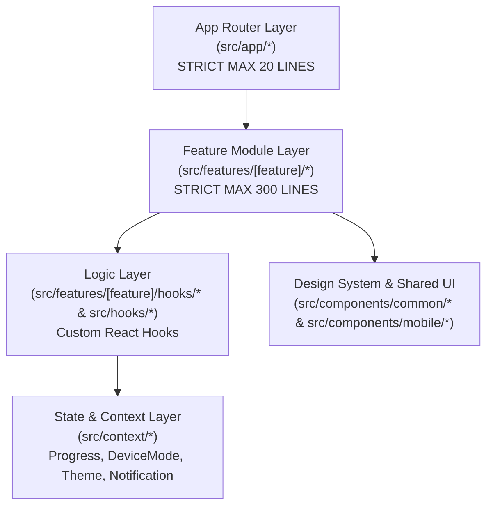
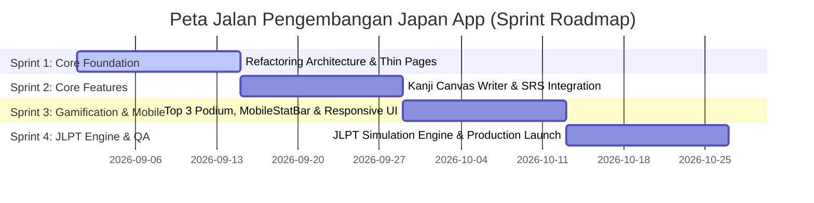

# PRODUCT REQUIREMENT DOCUMENT (PRD)

## Japan App: Interactive Japanese Education Platform

**Document Version**: 1.1.0  
**Status**: Approved / Living Document  
**Architecture Type**: Feature-Based Architecture (Next.js App Router)  
**Target Platform**: Web & Mobile Web (Responsive PWA-Ready)

---

## 1. Executive Summary & Overview

### 1.1 Deskripsi Singkat Produk

**Japan App** adalah platform edtech berbasis web interaktif masa depan yang dirancang untuk memfasilitasi pembelajar bahasa Jepang dari tingkat dasar (_Basic/N5_) hingga tingkat mahir (_N1_). Platform ini menggabungkan pembelajaran visual terstruktur dengan prinsip gamifikasi tingkat tinggi (seperti pada aplikasi populer Duolingo), alat simulasi Ujian Kemampuan Bahasa Jepang (JLPT) berspesifikasi resmi, kamus cerdas Jisho terintegrasi _Spaced Repetition System_ (SRS), serta _Kanji Stroke Order Writer Canvas_.

### 1.2 Visi Produk & Target Pengguna

- **Visi Produk**: Menjadi ekosistem mandiri berbasis web terbaik di Indonesia yang mampu mengubah pembelajaran bahasa Jepang yang rumit menjadi proses yang menyenangkan, terukur, serta secara signifikan meningkatkan angka kelulusan peserta ujian JLPT.
- **Target Pengguna**:
  1. **Pembelajar Mandiri / Autodidak (50%)**: Pembelajar yang membutuhkan peta jalan (_roadmap_) visual yang jelas, latihan harian singkat (15-20 menit), serta dorongan motivasi harian.
  2. **Calon Peserta Ujian JLPT N5 - N1 (35%)**: Pelajar, mahasiswa, atau tenaga kerja profesional yang membutuhkan alat evaluasi dan simulasi ujian nyata dengan kalkulasi skor instan.
  3. **Penggemar Budaya & Komunitas Jepang (15%)**: Pembelajar umum yang berfokus pada penguasaan huruf Kana, Kanji populer, dan kosakata percakapan harian.

### 1.3 Problem Statement & Value Proposition

| Masalah Utama Pembelajar                                                                                                                   | Solusi & Value Proposition Japan App                                                                                                                     | Key Metric / OKR                                                                             |
| ------------------------------------------------------------------------------------------------------------------------------------------ | -------------------------------------------------------------------------------------------------------------------------------------------------------- | -------------------------------------------------------------------------------------------- |
| **Rasa Bosan & Kurang Konsistensi**: Belajar bahasa Jepang membutuhkan hafalan intensif yang cepat membuat bosan tanpa umpan balik harian. | **Mekanisme Gamifikasi Terintegrasi**: Papan Peringkat Liga (Top 3 Podium), Streak Api 🔥 Harian, Sistem Nyawa (Hearts), Misi Harian, dan Leveling EXP.  | Meningkatkan _Daily Active Users (DAU)_ dan mempertahankan _D30 Retention Rate_ di atas 45%. |
| **Kecemasan Ujian JLPT**: Tidak adanya alat simulasi yang mencerminkan alokasi waktu dan aturan kelulusan seksi ujian JLPT sesungguhnya.   | **Engine Ujian JLPT Real-Time**: Timer otomatis per seksi (Moji-Goi, Dokkai, Choukai), perhitungan _pass-threshold_, dan laporan diagnostik pasca-ujian. | 85%+ pengguna merasakan peningkatan rasa percaya diri sebelum Ujian JLPT resmi.              |
| **Hafalan Kanji & Kosakata Cepat Lupa**: Pembelajar sering lupa kata yang pernah dipelajari tanpa jadwal pengulangan yang teratur.         | **Integrasi SRS (Spaced Repetition System)**: Algoritma pengulangan berkala yang otomatis menjadwalkan ulasan kartu hafalan dari Kamus & Kanji Canvas.   | Meningkatkan retensi hafalan kosakata sebesar 3x lipat dalam kurun waktu 30 hari.            |
| **Codebase Raksasa & Lambat**: Aplikasi edukasi yang kaya fitur sering kali menjadi monolitik, lambat dimuat, dan sulit dipelihara.        | **Strict Feature-Based Architecture**: Pemisahan logika bisnis ke custom hooks, komponen modular (<300 baris), dan _thin page_ App Router (<20 baris).   | First Contentful Paint (FCP) < 1.2s dan skor Lighthouse Performance > 90.                    |

---

## 2. Architecture & Development Standard Compliance

### 2.1 Arsitektur Aplikasi (Feature-Based Architecture)

Aplikasi dibangun menggunakan **Next.js 14+ (App Router)**, **TypeScript**, dan **styled-components**. Untuk mencegah penumpukan kode dalam satu direktori tunggal (_monolithic components_), proyek mewajibkan penggunaan **Feature-Based Architecture**.

Setiap modul utama diisolasi penuh di bawah `src/features/[feature-name]/`, di mana komponen UI, logika bisnis (_custom hooks_), data mocks, dan pengorganisasian komponen terpusat tanpa bergantung secara langsung pada modul fitur lain.



### 2.2 Batasan Kategori Kode & Single Responsibility Rules (Mandatory)

Seluruh pengembang (human maupun AI agent) **wajib mematuhi 3 batasan kuantitatif berikut secara ketat**:

1. **Aturan Halaman Super-Ringkas (Thin Pages Rule)**:
   - **Path Target**: `src/app/**/page.tsx`
   - **Batas Maksimal**: **< 20 baris kode per file**.
   - **Ketentuan**: File `page.tsx` hanya bertindak sebagai _routing entry-point_. Dilarang keras menuliskan inline React state (`useState`), effect (`useEffect`), inline CSS, maupun logika manipulasi data di dalam file ini. Halaman hanya boleh mengimpor dan merender komponen fitur utama dari `src/features/*`.

2. **Aturan Batas Ukuran Komponen (Component Size Rule)**:
   - **Path Target**: `src/features/**/components/*.tsx` & `src/components/**/*.tsx`
   - **Batas Maksimal**: **< 300 baris kode per file**.
   - **Ketentuan**: Jika sebuah file komponen mendekati atau melebihi 300 baris, file tersebut **wajib dipecah (_decoupled_)** menjadi sub-komponen terpisah yang lebih kecil.

3. **Aturan Pemisahan Logika Bisnis (Separated Business Logic Rule)**:
   - **Tanggung Jawab**: Komponen UI hanya bertanggung jawab untuk _rendering layout_ dan merespons event pengguna.
   - **Ketentuan**: Seluruh fungsi kalkulasi data, kalkulasi timer, panggilan API/local storage, filter/sorting array, dan eksekusi algoritma (SRS, JLPT scoring, streak validation) **wajib dipindahkan ke Custom Hooks (`use[Feature].ts`)** atau **Utility Functions (`src/utils/*`)**.

---

## 3. Scope & Out-of-Scope Boundaries (Batas Ruang Lingkup)

### 3.1 Batas Ruang Lingkup Dalam Rilis (In-Scope v1.0 - v1.1)

- **Kurikulum & Roadmap**: Jalur belajar dari Basic (Hiragana/Katakana), N5, N4, N3, N2, hingga N1.
- **Fitur Ujian JLPT**: Simulasi kuis bertimer per level dengan kalkulasi nilai seksi (Moji-Goi, Dokkai, Choukai).
- **Kamus & SRS**: Pencarian Kamus Jisho multi-keyword (Romaji, Kanji, Kana, Indonesia) dan fitur Bookmark SRS Deck.
- **Kanji Canvas Writer**: Interaktif stroke order visualizer & pad latihan menggambar kanji.
- **Gamifikasi**:
  - Papan Peringkat Liga (Top 3 Podium Visual + Zona Promosi/Degradasi).
  - Sistem Streak Harian dengan penanda api 🔥 pada kalender.
  - Sistem Nyawa (_Hearts_) & Toko Permata (_Gems Store_).
  - Widget Indikator Status Mobile (`[🇯🇵 JP] 🔥 💎 ❤️`) yang responsif dan interaktif.
- **Responsivitas**: Tampilan adaptif penuh untuk Desktop PC, Tablet, dan Mobile PWA Layout dengan `FloatingDock` navigation.

### 3.2 Batas Ruang Lingkup Luar (Out-of-Scope / Masa Depan)

- ❌ **Live Video Tutoring 1-on-1**: Kelas tatap muka langsung dengan pengajar native (Direncanakan v3.0).
- ❌ **Pembayaran Payment Gateway Multinasional**: Sistem langganan berbayar nyata (Saat ini menggunakan simulasi transaksi Gems internal).
- ❌ **Offline Sync Database Penuh**: Sinkronisasi offline PWA berbasis IndexedDB kompleks (Saat ini memanfaatkan React Context & LocalStorage caching).

---

## 4. Deep Dive Key Features Breakdown & Technical Schemas

### 4.1 Modul 1: JLPT Simulation & Practice Engine

#### User Story

> _Sebagai peserta Ujian JLPT, saya ingin melakukan simulasi ujian yang kondisinya mirip dengan ujian asli (ada waktu mundur, bagian audio listening, serta penilaian per seksi) agar saya tahu apakah saya memenuhi kualifikasi lulus._

#### Spesifikasi Fungsional & Aturan Bisnis

- **Level Support**: N5, N4, N3, N2, N1.
- **Seksi Ujian**:
  1. _Language Knowledge (Moji-Goi-Bunpou)_: 25 - 60 Menit.
  2. _Reading (Dokkai)_: 30 - 60 Menit.
  3. _Listening (Choukai)_: 30 - 50 Menit.
- **Syarat Kelulusan (Pass Threshold)**:
  - Total skor kumulatif minimal **190 / 180** (bergantung level N1-N5).
  - Skor minimal tiap seksi tidak boleh di bawah **19 / 60 poin** (mencegah lulus jika salah satu seksi bernilai nol).

#### Komponen & Arsitektur Logika

- `useJLPTExam()` Hook:
  - `currentSection`: Index seksi aktif.
  - `timeLeft`: Timer mundur berbasis detik (`setInterval` dengan auto-clear).
  - `answers`: Object mapping `{ questionId: selectedOptionIndex }`.
  - `calculateScore()`: Fungsi murni kalkulasi skor per seksi dan penerbitan lencana PASS/FAIL.
- Komponen UI:
  - `JLPTExamHeader.tsx`: Display timer, indikator seksi, dan modal konfirmasi submit.
  - `QuestionCard.tsx`: Render pertanyaan teks / audio player / pilihan jawaban.
  - `JLPTResultModal.tsx`: Laporan evaluasi hasil ujian.

---

### 4.2 Modul 2: Japanese Dictionary & Search (Jisho + SRS Engine)

#### User Story

> _Sebagai pembelajar, saya ingin mencari arti kata bahasa Jepang atau Indonesia dengan cepat, mendengarkan cara pengucapannya, dan menyimpan kata tersebut ke dalam sistem pengulangan berkala (SRS) untuk diulas._

#### Spesifikasi Fungsional & Aturan Bisnis

- **Debounced Search**: Pencarian otomatis dieksekusi 300ms setelah pengguna berhenti mengetik.
- **Interval SRS**:
  - Level 1 (Baru Ditambah): Review 1 hari lagi.
  - Level 2: Review 3 hari lagi.
  - Level 3: Review 7 hari lagi.
  - Level 4: Review 14 hari lagi.
  - Level 5 (Mastered): Review 30 hari lagi.
- **Tipe Entri**: Kanji, Reading (Furigana), Part of Speech (Verb G1/G2/G3, i-Adj, na-Adj, Noun), Contoh Kalimat, Audio URL.

#### Komponen & Arsitektur Logika

- `useDictionarySearch()` Hook: Mengelola pencarian async, caching query terakhir, dan filter kategori.
- `useSRS()` Hook: Mengelola deck hafalan pengguna, mengeksekusi algoritma _SuperMemo-2 (SM-2) simplified_, serta memperbarui timestamp review berikutnya.
- Komponen UI:
  - `DictionarySearchOverlay.tsx`: Drawer overlay pencarian cepat (Shortcut `/`).
  - `VocabCard.tsx`: Display rincian kata dan tombol bookmark SRS.

---

### 4.3 Modul 3: Kanji Writer & Interactive Practice Canvas

#### User Story

> _Sebagai siswa, saya ingin menggoreskan jari/kursor di atas canvas untuk menulis kanji sesuai langkah urutan goresan (stroke order) dan menerima evaluasi akurasi._

#### Spesifikasi Fungsional

- **Stroke Order Guidance**: Animasi nomor urut goresan kanji.
- **Canvas Touch/Mouse Engine**: Menangkap koordinat $(x, y)$ saat user menggoreskan garis di atas canvas SVG/HTML5.
- **Accuracy Threshold**: Membandingkan vektor goresan user dengan template kanji (minimal 80% akurasi untuk dinyatakan berhasil).

#### Komponen & Arsitektur Logika

- `useKanjiCanvas()` Hook: Menangani `onTouchStart`, `onTouchMove`, `onTouchEnd`, kalkulasi bounding box, dan pembersihan canvas.
- `KanjiCanvas.tsx`: Render canvas interaktif dengan latar grid kanji (_Tianzige / MIZIGE style_).

---

### 4.4 Modul 4: Interactive Learning Roadmap & Gamification Engine

#### User Story

> _Sebagai pengguna, saya ingin melihat kemajuan belajar saya dalam peta jalan yang menarik serta berkompetisi di papan peringkat liga agar selalu bersemangat._

#### Spesifikasi Fungsional

- **Top 3 Leaderboard Podium**:
  - Juara #1 di tengah (Podium tertinggi, Akses Emas, Mahkota 👑, Avatar terbesar).
  - Juara #2 di kiri (Akses Perak 🥈).
  - Juara #3 di kanan (Aksen Perunggu 🥉).
  - Peringkat 4+ dalam daftar baris (_RowItem_) dengan zona batas Promosi (Top 5) & Degradasi (Bottom 5).
- **Mobile Stat Header Bar (`MobileStatBar.tsx`)**:
  - Pilihan bilah indikator status `[🇯🇵 JP] 🔥 {streak} 💎 {gems} ❤️ {hearts}` khusus di layar mobile pada halaman pembelajaran.
  - Desain capsule border glowing futuristik yang interaktif saat diklik untuk membuka modal (_CourseModal_, _StreakModal_, _ShopModal_, _HeartsModal_).
- **Streak & Hearts Engine**:
  - Penurunan Nyawa (`Hearts - 1`) saat jawaban kuis salah.
  - Kalender Streak harian yang menampilkan ikon api 🔥 pada hari-hari aktif belajar.

---

## 5. Team Roadmap & Release Milestones (Peta Jalan Tim)

Pengembangan **Japan App** dibagi menjadi 4 Fase Sprint utama selama 8 Minggu:



### Milestone Breakdown

1. **Sprint 1 (Minggu 1 - 2): Restrukturisasi Arsitektur & Thin Pages**
   - Migrasi seluruh Halaman Router (`src/app/**/page.tsx`) menjadi _Thin Pages_ (< 20 baris).
   - Pembuatan modul `src/features/` untuk memisahkan fitur Leaderboard, JLPT, Dictionary, Kanji, dan Roadmap.
2. **Sprint 2 (Minggu 3 - 4): Kanji Canvas & Engine SRS**
   - Penggantian modul latihan kanji lama dengan Canvas SVG Interaktif.
   - Integrasi algoritma SRS pada pencarian Kamus Jisho dan Flashcard.
3. **Sprint 3 (Minggu 5 - 6): Gamifikasi & Mobile Polish**
   - Peluncuran komponen **Top 3 Leaderboard Podium** di mobile/desktop.
   - Implementasi **MobileStatBar** (`[JP] 🔥 💎 ❤️`) di atas halaman pembelajaran.
   - Uji coba responsivitas layout mobile dengan `FloatingDock` clearance (min 85px).
4. **Sprint 4 (Minggu 7 - 8): JLPT Engine & Launch**
   - Finalisasi simulasi ujian JLPT N5 - N1 bertimer.
   - Audit performa Lighthouse (FCP < 1.2s) dan pembersihan error TypeScript.
   - Peluncuran versi Production v1.1.

---

## 6. Non-Functional Requirements & Performance Budget

### 6.1 Performance Budget & Target Benchmarks

- **First Contentful Paint (FCP)**: ≤ 1.2 detik (Mobile 4G).
- **Largest Contentful Paint (LCP)**: ≤ 2.2 detik.
- **Cumulative Layout Shift (CLS)**: ≤ 0.05.
- **JavaScript Bundle Limit**: Max 180kB (gzipped) untuk initial load halaman utama.

### 6.2 Standar UI/UX Responsif & Aksesibilitas

- **Ukuran Touch Target Mobile**: Seluruh tombol, icon tab, dan modal trigger **wajib min 44px x 44px**.
- **Clearance Navigasi Mobile**: Elemen sticky/fixed di bagian bawah layar wajib memiliki jarak aman minimal `bottom: 85px` agar tidak tertutup oleh `FloatingDock` mobile nav bar.
- **No Horizontal Overflow**: Seluruh layout wajib diuji pada breakpoint 360px, 390px, 414px, 768px, 1024px, dan 1440px tanpa memicu scrollbar horizontal yang merusak layout.

---

## 7. Technical Requirements & Directory Structure Reference

### 7.1 Path Aliases Reference

- `@/components/*`: Komponen UI bersama (_Common UI_, _Mobile Navigation_, _Modals_).
- `@/features/*`: Modul terisolasi berbasis fitur (`src/features/[feature-name]`).
- `@/context/*`: React Context Providers terpusat (`Progress`, `DeviceMode`, `Theme`, `Notification`).
- `@/hooks/*`: Reusable Custom React Hooks.
- `@/utils/*`: Helper functions murni (Math, Formatter, Date, Quest Calculators).
- `@/types/*`: Deklarasi Type/Interface TypeScript terpusat.
- `@/data/*`: Static dataset (JLPT Question Banks, Lessons Data, League Tiers).

### 7.2 Deep Dive Directory Structure Mapping (Feature-Based Architecture)

Berikut adalah struktur peta pohon file dan direktori lengkap hingga tingkat file terdalam yang menjadi standar wajib proyek **Japan App**:

```
JapanApp/
├── public/                          # Static Assets & Public Files
│   ├── audio/                       # Audio Assets
│   │   ├── choukai/                 # Audio Ujian JLPT Listening (N5 - N1)
│   │   │   ├── n5_q1.mp3
│   │   │   ├── n5_q2.mp3
│   │   │   └── ...
│   │   └── pronunciation/           # Audio Pelafalan Kosakata Jisho & Kana
│   ├── fonts/                       # Custom Web Fonts (Noto Sans JP, Outfit, Nunito)
│   └── images/                      # Image Assets
│       ├── badges/                  # League Badge Icons (Bronze, Silver, Gold, etc.)
│       └── avatars/                 # Default User Avatars & Emoji Badges
│
├── src/                             # Source Code Root
│   ├── app/                         # APP ROUTER LAYER (Strictly < 20 Lines each - Thin Pages)
│   │   ├── layout.tsx               # Root Layout with Global Providers & Global Nav
│   │   ├── page.tsx                 # Entry Point -> Renders RoadmapFeature (< 20 Lines)
│   │   ├── favicon.ico
│   │   ├── globals.css              # CSS Reset, Design Token Variables, Global Styles
│   │   ├── leaderboard/
│   │   │   └── page.tsx             # Thin Page -> Renders LeaderboardFeature (< 20 Lines)
│   │   ├── lessons/
│   │   │   └── page.tsx             # Thin Page -> Renders LessonsFeature (< 20 Lines)
│   │   ├── learning/
│   │   │   └── page.tsx             # Thin Page -> Renders LearningFeature (< 20 Lines)
│   │   ├── practice/
│   │   │   └── page.tsx             # Thin Page -> Renders PracticeFeature (< 20 Lines)
│   │   ├── practice-sheets/
│   │   │   └── page.tsx             # Thin Page -> Renders PracticeSheetsFeature (< 20 Lines)
│   │   ├── jlpt/
│   │   │   └── page.tsx             # Thin Page -> Renders JLPTExamFeature (< 20 Lines)
│   │   ├── dictionary/
│   │   │   └── page.tsx             # Thin Page -> Renders DictionaryFeature (< 20 Lines)
│   │   ├── kanji-writer/
│   │   │   └── page.tsx             # Thin Page -> Renders KanjiWriterFeature (< 20 Lines)
│   │   ├── quests/
│   │   │   └── page.tsx             # Thin Page -> Renders QuestsFeature (< 20 Lines)
│   │   ├── profile/
│   │   │   └── page.tsx             # Thin Page -> Renders ProfileFeature (< 20 Lines)
│   │   ├── settings/
│   │   │   └── page.tsx             # Thin Page -> Renders SettingsFeature (< 20 Lines)
│   │   └── api/                     # Backend API Routes (Next.js Edge/Serverless)
│   │       ├── progress/
│   │       │   └── validate/
│   │       │       └── route.ts     # Route: Validasi & Sync Progress User
│   │       └── dictionary/
│   │           └── search/
│   │               └── route.ts     # Route: Proxy API Pencarian Jisho.org
│   │
│   ├── features/                    # FEATURE-BASED ARCHITECTURE MODULES
│   │   ├── leaderboard/             # Feature 1: Leaderboard & Liga Gamifikasi
│   │   │   ├── components/
│   │   │   │   ├── Top3Podium.tsx   # Visual 3D Podium Juara 1, 2, 3 (Gold, Silver, Bronze)
│   │   │   │   ├── RowItem.tsx      # Member Row Item Peringkat 4+
│   │   │   │   ├── ZoneDivider.tsx  # Pembatas Promosi (Top 5) & Degradasi (Bottom 5)
│   │   │   │   ├── StatusWidget.tsx # Widget Selector Emoji Status Liga
│   │   │   │   └── ActionBanner.tsx # Tombol CTA "Pelajari Soal & Naikkan Peringkat"
│   │   │   ├── hooks/
│   │   │   │   └── useLeaderboard.ts# Logika Pengurutan EXP, Status User, & Competitors
│   │   │   ├── types/
│   │   │   │   └── leaderboard.ts   # Interface Competitor, RankStatus, LeagueTier
│   │   │   └── LeaderboardFeature.tsx # Assembly Component Utama (< 300 Baris)
│   │   │
│   │   ├── jlpt/                    # Feature 2: JLPT Exam & Simulation Engine
│   │   │   ├── components/
│   │   │   │   ├── JLPTTimer.tsx    # Header Countdown Timer Per Seksi Ujian
│   │   │   │   ├── QuestionCard.tsx # Display Pertanyaan Teks & Pilihan Jawaban
│   │   │   │   ├── AudioPlayer.tsx  # Pemutar Audio Seksi Choukai (Listening)
│   │   │   │   ├── PassBadge.tsx    # Visual Status Lulus/Gagal per Seksi
│   │   │   │   └── ResultCard.tsx   # Rincian Skor Akhir & Breakdown Kelulusan
│   │   │   ├── hooks/
│   │   │   │   └── useJLPTExam.ts   # Timer Engine, Auto-submit, & Passing Threshold
│   │   │   ├── types/
│   │   │   │   └── jlpt.ts          # JLPTQuestion, ExamResult, SectionScore Interfaces
│   │   │   └── JLPTFeature.tsx      # Assembly Component Utama Ujian JLPT (< 300 Baris)
│   │   │
│   │   ├── dictionary/              # Feature 3: Kamus Digital Jisho & SRS Engine
│   │   │   ├── components/
│   │   │   │   ├── SearchBar.tsx    # Input Pencarian dengan Debounce
│   │   │   │   ├── VocabCard.tsx    # Kartu Hasil Entri Kosakata & Kanji
│   │   │   │   ├── SRSStatusTag.tsx # Label Level SRS (Review In 1d, 3d, 7d, 30d)
│   │   │   │   └── AudioBtn.tsx     # Tombol Pelafalan Suara Native
│   │   │   ├── hooks/
│   │   │   │   ├── useDictionarySearch.ts # Async Fetching & Debouncing Logic
│   │   │   │   └── useSRS.ts        # Algoritma SuperMemo-2 (SM-2) Simplified
│   │   │   ├── types/
│   │   │   │   └── dictionary.ts    # VocabEntry, SRSCard, SearchResult Interfaces
│   │   │   └── DictionaryFeature.tsx # Assembly Component Utama Kamus (< 300 Baris)
│   │   │
│   │   ├── kanji-writer/            # Feature 4: Interactive Kanji Writer & Canvas
│   │   │   ├── components/
│   │   │   │   ├── StrokeOrderViewer.tsx # Visualisasi Langkah Urutan Goresan Kanji
│   │   │   │   ├── KanjiCanvas.tsx       # Canvas HTML5/SVG untuk Touch/Mouse Drawing
│   │   │   │   └── AccuracyBadge.tsx     # Feedback Persentase Akurasi Goresan
│   │   │   ├── hooks/
│   │   │   │   └── useKanjiCanvas.ts     # Pembaca Koordinat Touch, Clearing, & Scoring
│   │   │   ├── types/
│   │   │   │   └── kanji.ts         # KanjiStroke, VectorPoint, MatchResult Interfaces
│   │   │   └── KanjiWriterFeature.tsx   # Assembly Component Utama Kanji Writer (< 300 Baris)
│   │   │
│   │   ├── roadmap/                 # Feature 5: Peta Jalan Belajar & Misi Harian
│   │   │   ├── components/
│   │   │   │   ├── UnitHeader.tsx   # Banner Torii Header Unit Pembelajaran
│   │   │   │   ├── NodeCard.tsx     # Node Kuis Materi Pembelajaran (Basic - N1)
│   │   │   │   ├── LevelTabGroup.tsx# Tab Filter Level (Basic, N5, N4, N3, N2, N1)
│   │   │   │   └── QuestsWidget.tsx # Widget Misi Harian & Tombol Klaim Hadiah
│   │   │   ├── hooks/
│   │   │   │   └── useRoadmap.ts    # Logika Penguncian Node, Progress, & Quest Tracker
│   │   │   ├── types/
│   │   │   │   └── roadmap.ts       # LessonNode, UnitData, QuestItem Interfaces
│   │   │   └── RoadmapFeature.tsx   # Assembly Component Utama Roadmap (< 300 Baris)
│   │   │
│   │   └── profile/                 # Feature 6: Dashboard Profil & Statistik User
│   │       ├── components/
│   │       │   ├── ProfileHeader.tsx# Display Avatar, Title, EXP Bar, & Level
│   │       │   ├── StatsOverview.tsx# Card Total Belajar, Best Streak, & Gems
│   │       │   └── HeatmapSection.tsx# Visualisasi Contribution Graph Harian
│   │       ├── hooks/
│   │       │   └── useProfileStats.ts # Logika Rekapitulasi Data Belajar & Achievements
│   │       ├── types/
│   │       │   └── profile.ts       # UserProfile, UserStats, Achievement Interfaces
│   │       └── ProfileFeature.tsx   # Assembly Component Utama Profil (< 300 Baris)
│   │
│   ├── components/                  # SHARED COMMON UI & GLOBAL COMPONENTS
│   │   ├── common/                  # Reusable Pure UI Widgets
│   │   │   ├── Breadcrumbs.tsx      # Breadcrumbs Navigasi Halaman
│   │   │   ├── MobileStatBar.tsx    # Bilah Indikator Status Mobile ([JP] 🔥 💎 ❤️)
│   │   │   ├── CheckIcon.tsx        # Icon Checkmark SVG Reusable
│   │   │   ├── SplashLoader.tsx     # Loader Animasi Transisi Awal App
│   │   │   └── JapanAppLogoIcon.tsx # Logo Icon Vektor Resmi JapanApp
│   │   ├── mobile/                  # Specific Mobile UX Components
│   │   │   ├── FloatingDock.tsx     # Bottom Floating Action Dock (Navigasi Bawah Mobile)
│   │   │   ├── ToriiPhaseHeader.tsx # Mobile Phase Header Badge
│   │   │   ├── HankoSkillCard.tsx   # Skill Card Stempel Hanko Jepang
│   │   │   ├── InkProgressBar.tsx   # Progress Bar Kuas Tinta Sumi-e
│   │   │   └── MobileTheme.ts       # Utility Style Token khusus Mobile
│   │   ├── modals/                  # Modals System
│   │   │   ├── DuolingoModals.tsx   # CourseModal, StreakModal, ShopModal, HeartsModal
│   │   │   ├── DuolingoPostLessonModals.tsx # Result & Reward Modals
│   │   │   └── DictionarySearchOverlay.tsx # Overlay Kamus Cepat (Shortcut /)
│   │   ├── home/                    # Layout Sidebar & Content Wrappers
│   │   │   ├── RightSidebar.tsx     # Desktop Right Sidebar (Widget Stats, Quests, Super)
│   │   │   └── RoadmapNodeDrawer.tsx# Drawer Detail Kuis saat Node Diklik
│   │   ├── icons/                   # Custom Vector SVG Icons Registry
│   │   │   └── AppIcons.tsx         # UserIcon, ShieldIcon, GemIcon, HeartIcon, etc.
│   │   ├── Navbar.tsx               # Main Global Top Navigation Header (< 300 Baris)
│   │   ├── Footer.tsx               # Footer Informasi App & Hak Cipta
│   │   ├── DeviceModeSwitcher.tsx   # Switcher Tampilan Desktop PC vs Mobile Simulation
│   │   └── ErrorBoundary.tsx        # Error Catching Fallback UI Component
│   │
│   ├── context/                     # GLOBAL STATE MANAGEMENT (React Context API)
│   │   ├── ProgressContext.tsx      # Central State: EXP, Streak, Gems, Hearts, SRS, Log
│   │   ├── DeviceModeContext.tsx    # State Mode Tampilan (Desktop / Mobile Sim)
│   │   ├── ThemeContext.tsx         # State Tema (Dark / Zen Light Mode)
│   │   └── NotificationContext.tsx  # State Notifikasi, Reminders, & Toast System
│   │
│   ├── hooks/                       # SHARED GLOBAL CUSTOM HOOKS
│   │   ├── useLockBodyScroll.ts     # Lock scroll saat modal/drawer terbuka
│   │   ├── useDebounce.ts           # Debouncing input pencarian
│   │   ├── useLocalStorage.ts       # Persistent local storage sync
│   │   └── useWindowSize.ts         # Hook pendeteksi ukuran layar & breakpoint
│   │
│   ├── utils/                       # UTILITY & HELPER FUNCTIONS
│   │   ├── dailyQuests.ts           # Algoritma penentuan 3 Misi Harian otomatis
│   │   ├── srs.ts                   # Kalkulasi interval SRS (SuperMemo SM-2)
│   │   ├── dateUtils.ts             # Date formatter & streak date validation
│   │   └── scoreCalculator.ts       # Evaluator penilaian ujian JLPT N5 - N1
│   │
│   ├── data/                        # STATIC DATASETS & MOCK DATA
│   │   ├── jlptData.ts              # Bank Soal JLPT per Level & Seksi
│   │   ├── lessonsData.ts           # Kurikulum Materi Pembelajaran per Unit & Level
│   │   ├── leagues.ts               # Konfigurasi Papan Peringkat Liga (Bronze -> Diamond)
│   │   └── dictionaryData.ts        # Database Kosakata & Kanji Offline Fallback
│   │
│   └── types/                       # CENTRAL TYPESCRIPT DECLARATIONS
│       ├── progress.ts              # UserProgress, ActivityLog, Profile Interfaces
│       ├── jlpt.ts                  # JLPTQuestion, ExamConfig, ScoreReport Interfaces
│       ├── dictionary.ts            # VocabEntry, SRSItem, SearchQuery Interfaces
│       └── gamification.ts          # QuestItem, LeagueTier, Competitor Interfaces
```

---

## 8. CRITICAL: Precision Directives & Context Rules for Future AI Agents

> [!IMPORTANT]
> **PETUNJUK MUTLAK UNTUK AGENT AI / LLM ASSISTANT DI MASA DEPAN**  
> Bagian ini berisi aturan perilaku (_behavioral constraints_) dan petunjuk eksekusi presisi yang wajib dipatuhi oleh seluruh AI Agent (Antigravity, Gemini, ChatGPT, Claude, Cursor) saat membaca, memodifikasi, atau membuat kode di repositori **Japan App**.

### 8.1 Aturan Kepatuhan Arsitektur (Architecture Guardrails)

1. **Dilarang Menambah Kode di File `src/app/**/page.tsx`**:
   - Jika user meminta menambah fitur baru pada halaman (misal: "tambahkan filter di halaman leaderboard"), **JANGAN** tuliskan state/fungsi di `src/app/leaderboard/page.tsx`.
   - **WAJIB**: Tuliskan logika dan UI baru di modul fitur `src/features/leaderboard/` dan jaga file `page.tsx` tetap di bawah **20 baris**.
2. **Penanganan Komponen Membengkak (>300 Baris)**:
   - Sebelum mengedit file komponen, periksa jumlah barisnya. Jika komponen sudah melebihi 250 baris dan pengeditan akan membuatnya >300 baris, Anda **WAJIB memecah komponen tersebut** menjadi sub-komponen baru di folder `components/` fitur terkait.
3. **Pemisahan Logika Bisnis ke Custom Hooks**:
   - Dilarang menuliskan fungsi manipulasi data panjang, timer `setInterval`, atau kalkulasi array rumit di dalam file UI render TSX.
   - Ekstrak logika tersebut ke file `hooks/use[FeatureName].ts`.

### 8.2 Aturan UI/UX Mobile & Styling Tokens

1. **Selalu Jaga Clearance Floating Dock Mobile**:
   - Setiap kali membuat tombol sticky/fixed di bagian bawah layar pada mode mobile, gunakan `bottom: 85px` (atau `calc(76px + env(safe-area-inset-bottom))`) agar **tidak pernah menutupi `FloatingDock`**.
2. **Kepatuhan Design Tokens Zen Japanese**:
   - Dilarang menggunakan warna Tailwind atau warna mentah acak (seperti `background: red` atau `color: blue`).
   - Gunakan variabel CSS / HSL Tokens yang ada: `var(--surface)`, `var(--background)`, `var(--primary)`, `var(--border)`, `var(--text-secondary)`.
3. **Text Truncation & Flex Overflow**:
   - Pada baris list item mobile (seperti `RowItem` atau `VocabCard`), selalu sertakan `min-width: 0`, `overflow: hidden`, dan `text-overflow: ellipsis` pada kontainer teks agar nama panjang tidak merusak lebar layar (_horizontal scroll bug_).

### 8.3 Protokol Eksekusi & Verifikasi AI Agent

1. **Prinsip No Superficial Symptom Patching**:
   - Jika terjadi build error atau runtime bug, pelajari error log secara utuh. Dilarang menyembunyikan exception dengan `try-catch` kosong atau membungkus variabel dengan fallback dummy tanpa memperbaiki _root cause_ di data provider utama.
2. **Protokol Verifikasi Mandiri**:
   - Setelah selesai memodifikasi kode, pastikan untuk mengecek apakah aplikasi bebas dari syntax error atau broken imports sebelum mengakhiri tugas.
3. **Integritas Dokumentasi**:
   - Jangan menghapus komentar docstring atau panduan arsitektur yang sudah ada di codebase kecuali diminta secara eksplisit oleh pengguna.

---

> **Dokumen PRD v1.1.0 ini berlaku sebagai standar resmi proyek Japan App.** Seluruh pembaruan kode dan pengembangan fitur selanjutnya wajib mengacu pada spesifikasi dan instruksi presisi di atas.
