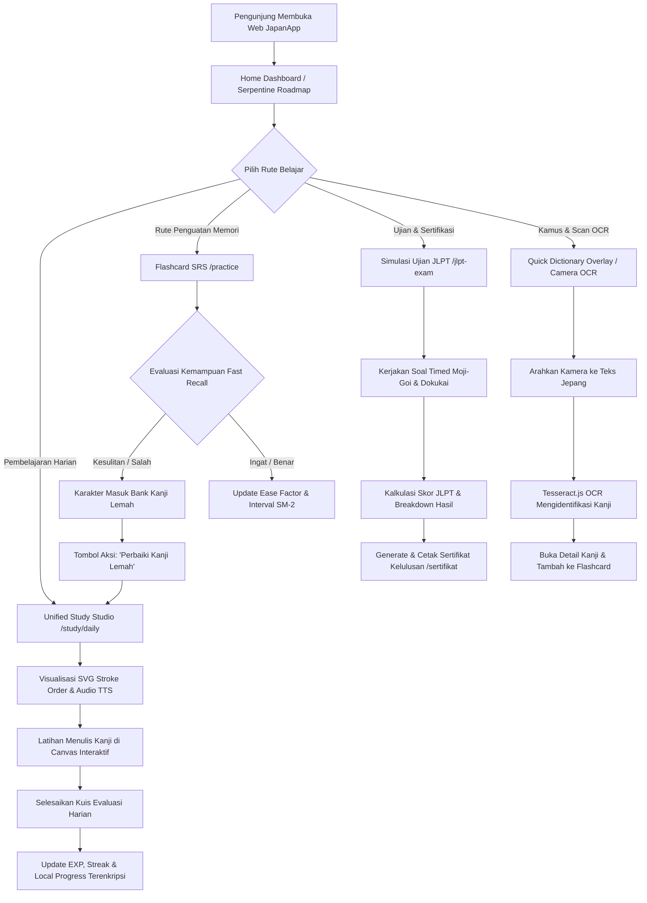

# 📄 Dokumentasi Arsitektur & Panduan Pengkodean Projek JapanApp

Dokumen ini berisi panduan menyeluruh mengenai **Tech Stack**, **Daftar Library**, **Struktur Folder**, **Arsitektur Data Terstruktur**, **Alur Kerja Web (User Flow)**, serta **Alur Coding (Developer Guide)** untuk platform **JapanApp (Interactive Japanese Learning & Mastery Platform)**.

---

## 📌 1. Ringkasan Proyek

Projek **JapanApp** adalah aplikasi web interaktif berbasis **Next.js 16 (App Router)** dan **React 19** yang dirancang sebagai platform pembelajaran bahasa Jepang komprehensif (Hiragana, Katakana, Kanji N5–N1, Tata Bahasa, Kosakata, Choukai/Listening, Kaiwa/Speaking, Simulasi Ujian JLPT, dan Game Edukasi).

### 🎯 Fokus Utama Arsitektur:
- **Performa & Offline PWA Readiness**: Dilengkapi Progressive Web App (`@ducanh2912/next-pwa`) dan enkripsi penyimpanan lokal berbasis client-side untuk responsivitas instan dan pengalaman belajar tanpa lag.
- **Clean Code & Modularitas**: Setiap komponen UI dibangun secara terisolasi dan dibatasi **< 300 baris kode** (jika membesar dipisah menjadi sub-komponen) agar mudah dirawat dan diuji.
- **Arsitektur Data Terpisah (`src/data/`)**: Seluruh isi dataset Kanji, Kana, Tata Bahasa, Latihan Choukai/Kaiwa, dan Simulasi JLPT dipisahkan dari logika UI, memudahkan penambahan materi tanpa mengubah komponen visual.
- **UX Pembelajaran Interaktif Modern**: Fitur unggulan seperti **Unified Single-Page Memorization Studio**, **SVG Animated Stroke Order Writer** (HanziWriter), **Tactile Canvas Handwriting** (Perfect Freehand), **Live Camera Kanji OCR Scanner** (Tesseract.js), **Weak Kanji Repair Bank**, dan **Gamified Serpentine Roadmap**.

---

## 🛠️ 2. Tech Stack & Daftar Library

Berikut adalah daftar teknologi dan library utama yang digunakan dalam projek ini beserta kegunaannya:

### Core Framework & Bahasa
| Teknologi | Versi | Kegunaan |
| :--- | :--- | :--- |
| **Next.js** | `16.1.0` | Framework React modern dengan App Router, Server/Client Components, dan optimasi build |
| **React** | `19.2.3` | Library antarmuka pengguna (UI Rendering Engine) versi 19 |
| **TypeScript** | `^5` | Pemrograman JavaScript dengan Strict Static Typing untuk keamanan kode |

### State Management & Security
| Library / API | Versi / Tipe | Kegunaan |
| :--- | :--- | :--- |
| **React Context** | `Built-in` | Pengelolaan state global aplikasi (`ProgressContext`, `ThemeContext`, `DeviceModeContext`) |
| **Web Crypto API (AES-GCM 256-bit)** | `Native Browser` | Enkripsi aman data progres pengguna di `localStorage` dengan skema dekripsi legacy RC4 fallback |
| **Zod** | `^3.22.4` | Validador skema data dan tipe dinamis |

### Styling, UI & Animasi
| Library | Versi | Kegunaan |
| :--- | :--- | :--- |
| **Styled Components** | `^6.3.8` | CSS-in-JS styling engine untuk komponen interaktif dan custom layout |
| **Tailwind CSS** | `Built-in` | Utility-first CSS framework untuk penataan gaya responsif |
| **Framer Motion** | `^12.38.0` | Library animasi transisi halaman, modal, card flip, dan feedback mikro |
| **Canvas Confetti** | `^1.9.4` | Animasi selebrasi visual saat menyelesaikan kuis, quest, dan level |

### Engine Bahasa Jepang, Canvas & Game Drag-and-Drop
| Library | Versi | Kegunaan |
| :--- | :--- | :--- |
| **Wanakana** | `^5.3.1` | Konversi otomatis Romaji ke Hiragana/Katakana & penanganan input teks Jepang |
| **Hanzi Writer** | `^3.7.3` | Engine rendering stroke order Kanji berbasis vector SVG interaktif |
| **Perfect Freehand** | `^1.2.3` | Algoritma penggambaran garis kuas halus untuk lembar latihan menulis Kanji/Kana |
| **Tesseract.js** | `^7.0.0` | OCR Client-side untuk pemindaian karakter Jepang dari kamera atau file gambar |
| **@dnd-kit/core, sortable, utilities**| `^6.3.1 / ^10.0.0` | Engine Drag-and-Drop untuk kuis menyusun kalimat dan game mencocokkan kartu |
| **@ducanh2912/next-pwa** | `^10.2.9` | Modul Progressive Web App (PWA) untuk dukungan offline dan service worker |

---

## 📁 3. Struktur Folder Projek

```text
JAPANAPP
├── docs/                      # Dokumentasi Teknis Proyek
│   └── DOCUMENTATION.md
├── public/                    # Aset Statis, Icon PWA, Service Worker & Registry JSON
│   ├── assets/
│   ├── Icon.json
│   ├── manifest.json
│   └── sw.js
├── scripts/                   # Script Utility Build, Check-Env, & Scraping Data
│   ├── check-env.js           # Verifikasi Lingkungan & Dependensi
│   ├── smoke-test.js          # Pengujian Jalur Utama Aplikasi
│   ├── enrichGrammar.mjs      # Enricher Dataset Tata Bahasa
│   ├── enrichKanji.mjs        # Enricher Stroke Path Kanji
│   └── build-twa.sh           # Script Build Trusted Web Activity (Android TWA)
├── src/
│   ├── app/                   # Next.js App Router (50+ Rute Pembelajaran & Fitur)
│   │   ├── layout.tsx         # Root Layout, Registry Styled-Components & Providers
│   │   ├── page.tsx           # Home Dashboard Orchestrator
│   │   ├── study/             # Unified Single-Page Study Studio & Daily Quizzes
│   │   ├── jlpt/              # Rute Pembelajaran JLPT & Kanji Writer
│   │   ├── jlpt-exam/         # Simulasi Ujian JLPT N5-N1 dengan Timer
│   │   ├── roadmap/           # Peta Jalan Pembelajaran Ular (Serpentine 3D Roadmap)
│   │   ├── kana/              # Tabel Hiragana & Katakana Interaktif
│   │   ├── kanji/             # Perpustakaan & Pencarian Kanji N5-N1
│   │   ├── grammar/           # Latihan Tata Bahasa & Partikel (Wa/Ga, Ni/De)
│   │   ├── vocabulary/        # Kamus Kosakata & Pencarian Quick Jisho
│   │   ├── practice/          # Hub Latihan, Flashcard SRS & Box Leitner
│   │   ├── practice-sheets/   # Lembar Kerja Menulis Kanji/Kana (Worksheets)
│   │   ├── game/              # Mini Game RPG Kanji Battle
│   │   ├── match-pairs/       # Game Mencocokkan Kartu Kanji/Kana
│   │   ├── reverse-quiz/      # Kuis Ketik Terbalik (Arti -> Kanji)
│   │   ├── quests/            # Quest Harian, Mingguan & Sistem Liga (Leagues)
│   │   ├── profile/           # Profil Pengguna, Statistik & Achievement Badges
│   │   ├── sertifikat/        # Generator & Cetak Sertifikat Kelulusan
│   │   ├── stats/             # Dashboard Analitik & Heatmap Belajar
│   │   ├── blog/              # Artikel Edukasi & Etika Bahasa Jepang
│   │   └── settings/          # Pengaturan Aplikasi, Mode Perangkat & Backup State
│   ├── components/            # Komponen UI Reusable (< 300 Baris Kode)
│   │   ├── Navbar.tsx         # Sticky Navigation & Status XP/Hearts/Streak
│   │   ├── Footer.tsx         # Footer Section & Link Komunitas
│   │   ├── ErrorBoundary.tsx  # Penangkap Error Runtime React
│   │   ├── KanaKeyboard.tsx   # Custom Virtual Keyboard Kana
│   │   ├── DictionaryFlashcardModal.tsx # Modal Kamus Jisho + Camera OCR
│   │   ├── common/            # Komponen Umum (Button, Badge, Modal, Input)
│   │   ├── home/              # Komponen Khusus Landing & Home Page
│   │   ├── jlpt/              # Komponen Khusus Modul Ujian JLPT
│   │   ├── practice/          # Komponen Flashcard, Drawing Canvas & Drills
│   │   └── roadmap/           # Komponen Node & Vector Path Roadmap 3D
│   ├── context/               # React Context Providers
│   │   ├── ProgressContext.tsx # Central Progress State (XP, Streak, Hearts, SRS, Weak Bank)
│   │   ├── ThemeContext.tsx    # State Theme Dark/Light
│   │   └── DeviceModeContext.tsx # Toggle Mode Tampilan Mobile/Desktop
│   ├── data/                  # Sumber Data Konten Terpisah (Tanpa Hardcode UI)
│   │   ├── kanji.ts           # Dataset Kanji (Stroke, Radical, On/Kun, Meaning)
│   │   ├── kana.ts            # Dataset Hiragana & Katakana
│   │   ├── grammarLessons.ts  # Dataset Tata Bahasa & Pola Kalimat
│   │   ├── listening.ts       # Dataset Audiori Choukai
│   │   ├── speaking.ts        # Dataset Latihan Percakapan Kaiwa
│   │   ├── reading.ts         # Dataset Wacana Membaca Dokukai
│   │   ├── conjugation_drills.ts # Drills Konjugasi Kata Kerja
│   │   ├── particles_drills.ts   # Drills Penggunaan Partikel Bahasa Jepang
│   │   ├── leagues.ts         # Peringkat Liga (Bronze, Silver, Gold, Master)
│   │   ├── lessons/           # Dataset Modul Pembelajaran Berdasarkan Level
│   │   │   ├── n5.ts, n4.ts, n3.ts, n2.ts, n1.ts, basic.ts, roadmap.ts
│   │   └── jlpt/              # Dataset Ujian & Simulasi Ujian JLPT
│   │       ├── levels/        # Data Kanji per Level N5–N1
│   │       └── Simulasi_Ujian/# Paket Soal Ujian Timed JLPT
│   ├── features/              # Modul Fitur Spesifik
│   │   └── daily-study/       # Feature Core Study Studio
│   │       ├── components/    # UnifiedStudyStudio, DailyDashboard, InteractiveStrokeWriter
│   │       ├── utils/         # strokePaths.ts (Vector Path Fallback)
│   │       └── types.ts       # Tipe Data Daily Study & Weak Bank
│   ├── hooks/                 # Custom React Hooks
│   └── lib/                   # Utility Core, Algorithm & Storage Helpers
│       ├── encryption.ts      # AES-GCM 256-bit Web Crypto Encryption & Legacy Fallback
│       ├── srs.ts             # Algoritma SuperMemo SM-2 Spaced Repetition
│       ├── leitner.ts         # Algoritma Kotak Leitner Memory Retention
│       ├── audio.ts           # Utility Web Audio API & Native SpeechSynthesis TTS
│       ├── dictionary.ts      # Engine Kamus Offline/Online Jisho
│       └── validation.ts      # Skema Validasi Form & State Data
├── next.config.ts
├── package.json
└── tsconfig.json
```

---

## 🗃️ 4. Arsitektur Data Terstruktur (`src/data/` & State Layer)

Untuk memisahkan logika antarmuka dengan sumber materi, seluruh data terstruktur dikelompokkan dan dikelola melalui layer berikut:

### 1. File Dataset Konten (`src/data/`)
- **`kanji.ts`**: Menampung array objek data Kanji (karakter, stroke count, radikal, Onyomi, Kunyomi, Romaji, arti Bahasa Indonesia, contoh Jukugo, dan Confusable Kanji).
- **`kana.ts`**: Menampung huruf Hiragana & Katakana beserta urutan stroke, audio file, dan grup kategori (Vowels, K-group, S-group, Dakuten, Yoon).
- **`grammarLessons.ts`**: Menampung struktur pola kalimat, penjelasan rumus gramatikal, contoh kalimat, dan soal latihan interaktif.
- **`lessons/ (n5.ts - n1.ts)`**: Menampung bab pembelajaran terpeta yang memasok unit Kosakata, Tata Bahasa, Choukai, dan Dokukai secara deterministik.
- **`jlpt/Simulasi_Ujian/`**: Menampung paket soal simulasi ujian JLPT yang mencakup bagian Moji-Goi, Bunpou-Dokukai, dan Choukai lengkap dengan timer.

### 2. State Progress & Keamanan Terenkripsi (`src/context/ProgressContext.tsx` & `src/lib/encryption.ts`)
Seluruh progres belajar pengguna disimpan secara aman di `localStorage` menggunakan standar enkripsi modern:
- **Engine Enkripsi (`AES-GCM 256-bit`)**: Menggunakan `window.crypto.subtle` dengan key derivation SHA-256 dan 12-byte random Initialization Vector (IV).
- **Graceful Fallback**: Jika dekripsi AES-GCM menemui kendala pada browser lama, sistem secara otomatis beralih ke skema legacy RC4 agar data pengguna tidak pernah hilang.
- **Struktur Progress State**:
  - `xp`, `streak`, `hearts`, `gems`, `level`
  - `learnedKanji`, `learnedKana`, `learnedVocab`, `learnedGrammar`
  - `srsCards` (Ease Factor, Interval, Next Review Date berdasarkan SuperMemo SM-2)
  - `weakKanjiBank` (Karakter yang memiliki Ease Factor < 2.2 atau sering salah saat kuis)
  - `bookmarks`, `unlockedBadges`, `completedQuests`

### 3. Engine Memory Retention (SRS & Leitner)
- **`srs.ts` (SuperMemo SM-2)**: Menghitung tanggal pengulangan berikutnya berdasarkan penilaian pengguna (`0: Blackout` s/d `5: Perfect`).
- **`leitner.ts`**: Mengelola perpindahan kartu flashcard antar kotak (Box 1 s/d Box 5) untuk penguatan memori jangka panjang.

---

## 🔄 5. Alur Kerja Aplikasi (Web User Flow)



### Rincian UX Key Features:
1. **Unified Single-Page Study Studio (`UnifiedStudyStudio.tsx`)**:
   - Kolom Kiri: Canvas SVG Stroke Order interaktif dengan kontrol animasi replay, panduan stroke numerik (`❶↓ ❷→`), dan Web Audio / SpeechSynthesis TTS.
   - Kolom Kanan: Detail arti Bahasa Indonesia, On'yomi, Kun'yomi, pasangan kata **Jukugo**, dan kartu peringatan **Awas Tertukar (Confusable Kanji)**.
2. **Bank Kanji Lemah Real-Time (`Bank Kanji Lemah`)**:
   - Membaca otomatis item dengan memori terdeteksi lemah (Ease Factor < 2.2) dari `ProgressContext`.
   - Menyediakan tombol aksi langsung `🛠️ Perbaiki Kanji Lemah` untuk sesi pemulihan terfokus.
3. **Kamus Quick Jisho & Live Camera OCR Scanner**:
   - Dapat dipanggil dari mana saja melalui tombol overlay atau shortcut keyboard.
   - Pemindaian karakter instan dari foto/kamera menggunakan **Tesseract.js** tanpa membutuhkan server pihak ketiga.

---

## 💻 6. Alur Coding & Panduan Pengembang (Developer Guide)

### A. Perintah Dasar Terminal
```bash
# 1. Jalankan server pengembangan (Development)
npm run dev

# 2. Jalankan pemeriksaan lingkungan & dependensi
npm run check-env

# 3. Jalankan pengujian smoke-test lokal
npm run smoke-test:local

# 4. Rilis build produksi (Production Build Check)
npm run build

# 5. Jalankan server hasil build
npm run start

# 6. Jalankan pemindaian linter
npm run lint
```

### B. Mengubah / Menambah Materi & Kanji
- **Menambah Kanji Baru**: Buka `src/data/kanji.ts` lalu tambahkan objek kanji baru sesuai antarmuka `DetailedItemData`.
- **Mengubah Soal Simulasi JLPT**: Buka `src/data/jlpt/Simulasi_Ujian/` pada folder level yang sesuai (misal `N5/`), lalu perbarui paket soal.
- **Menambah Bab Pembelajaran Roadmap**: Buka `src/data/lessons/roadmap.ts` dan tambahkan node unit pembelajaran baru.

### C. Konvensi Penulisan Kode (Coding Guidelines)
1. **Batas Baris Komponen (< 300 Baris)**: Komponen UI hendaknya tidak melebihi 300 baris kode. Jika komponen membesar karena logika state atau modal, pecah menjadi sub-komponen terisolasi di folder komponen terkait.
2. **Pencegahan Hydration Mismatch (`isMounted` Guard)**:
   Karena data progres pengguna dibaca dari `localStorage` terenkripsi secara asinkron, komponen Client Components WAJIB menggunakan guard `isMounted` atau `useEffect` sebelum merender nilai state pengguna agar tidak memicu mismatch antara SSR Next.js dan Client DOM:
   ```tsx
   const [isMounted, setIsMounted] = useState(false);
   useEffect(() => {
     setIsMounted(true);
   }, []);

   if (!isMounted) return <LoadingSpinner />;
   ```
3. **Penanganan Audio TTS Fallback**: Gunakan selalu fungsi pembantu dari `src/lib/audio.ts` untuk memutar audio pengucapan. Jika file `.mp3` fisik tidak ditemukan, sistem akan beralih ke `window.speechSynthesis` (ja-JP) secara transparan.
4. **Optimasi Web Freehand Canvas**: Saat mengembangkan canvas latihan menulis (`Perfect Freehand`), pastikan pembersihan path dilakukan menggunakan `requestAnimationFrame` untuk menjaga performa rendering tetap 60 FPS pada perangkat mobile.

---

*Dokumentasi ini dibuat dan dipelihara secara otomatis untuk menjaga standar pengembangan dan arsitektur JapanApp.*
