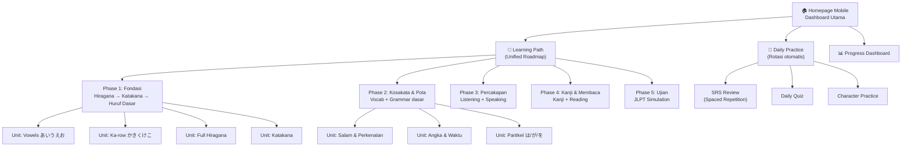

# JapanApp — Analisis & Rencana Perbaikan UI/UX

## 🔍 Ringkasan Analisis

Setelah menganalisis keseluruhan codebase (~170+ file, 68K+ baris kode), saya menemukan tiga masalah inti yang saling terkait:

---

## BAGIAN 1: Analisis Alur Belajar (Learning Flow)

### Kondisi Saat Ini — Mengapa Berantakan

Situs memiliki **terlalu banyak entry point** yang tidak saling terhubung, menciptakan kebingungan navigasi:

| Entry Point        | Halaman                                                                                                    | Fungsi                                      |
| ------------------ | ---------------------------------------------------------------------------------------------------------- | ------------------------------------------- |
| Homepage → Mobile  | [page.tsx](file:///home/nxrts/Program%20Koding/Japan-App/src/app/page.tsx)                                 | Roadmap serpentine (Duolingo-style)         |
| Homepage → Desktop | [page.tsx](file:///home/nxrts/Program%20Koding/Japan-App/src/app/page.tsx)                                 | Landing page marketing                      |
| Study Hub          | [study/page.tsx](file:///home/nxrts/Program%20Koding/Japan-App/src/app/study/page.tsx)                     | 8 kategori studi (Reading, Listening, dll.) |
| Roadmap            | [roadmap/page.tsx](file:///home/nxrts/Program%20Koding/Japan-App/src/app/roadmap/page.tsx)                 | Data roadmap terpisah dari lessonsData      |
| JLPT Hub           | [jlpt/page.tsx](file:///home/nxrts/Program%20Koding/Japan-App/src/app/jlpt/page.tsx)                       | Mini-test, flashcards, quiz per level       |
| Characters         | [characters/page.tsx](file:///home/nxrts/Program%20Koding/Japan-App/src/app/characters/page.tsx)           | Tabel Hiragana/Katakana                     |
| Practice           | [practice/page.tsx](file:///home/nxrts/Program%20Koding/Japan-App/src/app/practice/page.tsx)               | Latihan terpisah                            |
| Practice Sheets    | [practice-sheets/page.tsx](file:///home/nxrts/Program%20Koding/Japan-App/src/app/practice-sheets/page.tsx) | Lembar latihan menulis                      |
| Quiz Hub           | [quiz/page.tsx](file:///home/nxrts/Program%20Koding/Japan-App/src/app/quiz/page.tsx)                       | Quiz Kana & Writing                         |
| Game Hub           | [game/page.tsx](file:///home/nxrts/Program%20Koding/Japan-App/src/app/game/page.tsx)                       | 4 mini-games                                |

#### Masalah Utama:

1. **Dua sistem data roadmap yang tidak konsisten:**
   - [lessonsData.ts](file:///home/nxrts/Program%20Koding/Japan-App/src/data/lessonsData.ts) — 57 lesson dalam 15 unit (digunakan di mobile homepage)
   - [roadmap.ts](file:///home/nxrts/Program%20Koding/Japan-App/src/data/roadmap.ts) — 5 chapter dengan 16 lesson (digunakan di `/roadmap`)
2. **Tidak ada "satu pintu masuk":** Pengguna baru bingung harus mulai dari mana — Characters? Study? Roadmap? JLPT?

3. **Materi N5 terlalu banyak (10 unit), sementara N4–N1 sangat minim:**
   - N5: 10 unit (n5-u1 sampai n5-u10)
   - N4: 2 unit (n4-u1, n4-u2)
   - N3: 1 unit (n3-u1)
   - N2: 1 unit (n2-u1)
   - N1: 1 unit (n1-u1)

4. **Konten redundan:** Quiz, Practice, JLPT Practice, Daily Quiz — semuanya memiliki mekanik quiz serupa tanpa pembeda jelas.

---

### Rekomendasi: Alur Belajar Sistematis



#### Prinsip Desain Alur yang Direkomendasikan:

1. **Satu Pintu Masuk → Learning Path terpadu** yang menggabungkan `lessonsData.ts` dan `roadmap.ts` menjadi satu sumber data
2. **Progression Lock yang konsisten** — setiap unit harus diselesaikan sebelum membuka unit berikutnya
3. **Skill Tree, bukan linear path** — setiap unit memiliki 3 tipe aktivitas: Belajar → Latihan → Ujian
4. **Daily Practice otomatis** — sistem merotasi materi berdasarkan SRS yang sudah ada

#### Perubahan Data yang Diusulkan:

Gabungkan [lessonsData.ts](file:///home/nxrts/Program%20Koding/Japan-App/src/data/lessonsData.ts) dan [roadmap.ts](file:///home/nxrts/Program%20Koding/Japan-App/src/data/roadmap.ts) menjadi satu unified data source:

```typescript
// Proposed: src/data/learningPath.ts
interface LearningPhase {
  id: string;
  title: string; // e.g., "Fondasi Huruf"
  subtitle: string;
  level: "N5" | "N4" | "N3" | "N2" | "N1";
  phase: number; // 1-5
  units: LearningUnit[];
}

interface LearningUnit {
  id: string;
  title: string;
  description: string;
  color: string;
  skills: UnitSkill[]; // 3 skill per unit: Learn, Practice, Test
}

interface UnitSkill {
  id: string;
  type: "learn" | "practice" | "test";
  title: string;
  href: string;
  questions?: Question[];
  expReward: number;
}
```

---

## BAGIAN 2: Masalah Mode Mobile — Identitas Duolingo

### Elemen yang Terlalu Mirip Duolingo

Saya mengidentifikasi **7 elemen visual** di mode mobile yang sangat mirip Duolingo:

| #   | Elemen                    | File                                                                                                         | Deskripsi Masalah                                                         |
| --- | ------------------------- | ------------------------------------------------------------------------------------------------------------ | ------------------------------------------------------------------------- |
| 1   | **Serpentine Roadmap**    | [page.tsx L284-353](file:///home/nxrts/Program%20Koding/Japan-App/src/app/page.tsx#L284-L353)                | Node bulat bergerak zig-zag — signature Duolingo                          |
| 2   | **Circular Node Buttons** | [page.tsx L394-472](file:///home/nxrts/Program%20Koding/Japan-App/src/app/page.tsx#L394-L472)                | Tombol 76px bundar dengan 3D border-bottom — identik Duolingo             |
| 3   | **Star/Lock/Check Icons** | [page.tsx L149-240](file:///home/nxrts/Program%20Koding/Japan-App/src/app/page.tsx#L149-L240)                | 3 state icon (⭐/🔒/✓) dalam node — copy Duolingo                         |
| 4   | **"START" Tooltip**       | [page.tsx L355-392](file:///home/nxrts/Program%20Koding/Japan-App/src/app/page.tsx#L355-L392)                | Floating "START" tooltip di node aktif — Duolingo signature               |
| 5   | **Bottom Tab Bar**        | [Navbar.tsx L1802-1871](file:///home/nxrts/Program%20Koding/Japan-App/src/components/Navbar.tsx#L1802-L1871) | 6-tab bottom bar (Learn, Characters, Practice, JLPT, Game, Profile)       |
| 6   | **Unit Banner Cards**     | [page.tsx L246-282](file:///home/nxrts/Program%20Koding/Japan-App/src/app/page.tsx#L246-L282)                | Gradient cards dengan "SECTION: ..." dan "UNIT N" — Duolingo unit headers |
| 7   | **Level Tab Selector**    | [page.tsx L91-143](file:///home/nxrts/Program%20Koding/Japan-App/src/app/page.tsx#L91-L143)                  | Tab N5–N1 dengan 3D border-bottom — Duolingo aesthetic                    |

### Kekuatan Desktop yang Sudah Baik

Mode desktop memiliki identitas visual yang kuat:

- **Sidebar navigasi** ([Navbar.tsx L713-936](file:///home/nxrts/Program%20Koding/Japan-App/src/components/Navbar.tsx#L713-L936)) — premium, bersih
- **Dot-grid background** ([globals.css L92-101](file:///home/nxrts/Program%20Koding/Japan-App/src/app/globals.css#L92-L101)) — signature JapanApp
- **Color palette** Indigo (#4f46e5) + Emerald (#10b981) — unik, bukan Duolingo green
- **Hero Section** ([HeroSection.tsx](file:///home/nxrts/Program%20Koding/Japan-App/src/components/home/HeroSection.tsx)) — professional landing page
- **Study Hub** cards — glassmorphism dengan hover effects premium

---

## BAGIAN 3: Konsep UI/UX Mobile — Identitas "Zen Japanese"

> [!IMPORTANT]
> Konsep visual baru: **"Zen Japanese"** — menggabungkan estetika minimalis Jepang modern (wabi-sabi, ma/間) dengan teknologi modern. Ketika orang melihat, mereka langsung tahu ini JapanApp.

### Konsep Visual Utama

#### A. Pengganti Serpentine Path → **"Torii Gate Chapters"**

Alih-alih path serpentine ala Duolingo, gunakan konsep **Torii Gates** (gerbang kuil Jepang) sebagai penanda kemajuan visual:

```
┌─────────────────────────────────┐
│  ⛩️ PHASE 1: Fondasi Huruf     │  ← Torii Gate header
│  ┌─────┐ ┌─────┐ ┌─────┐      │
│  │ あ  │ │ か  │ │ 🏆  │      │  ← Horizontal card scroll
│  │Learn│ │Drill│ │Test │      │
│  └─────┘ └─────┘ └─────┘      │
│  ─────── Progress Bar ──────── │
│                                │
│  ⛩️ PHASE 2: Kosakata Dasar    │  ← Next Torii Gate
│  🔒 Complete Phase 1 first     │
│                                │
│  ⛩️ PHASE 3: Percakapan        │
│  🔒 Complete Phase 2 first     │
└─────────────────────────────────┘
```

**Elemen visual pembeda:**

- **Torii Gate SVG** sebagai separator antar phase — bukan unit cards gradient Duolingo
- **Horizontal scroll cards** untuk skills dalam unit — bukan vertical serpentine nodes
- **Ink brush stroke progress bar** — bukan progress bar biasa
- **Washi paper texture** pada card backgrounds — bukan flat colors

#### B. Pengganti Circular Nodes → **"Hanko Stamp Cards"**

Alih-alih tombol bulat 3D ala Duolingo, gunakan **Hanko Stamps** (cap resmi Jepang):

```
┌──────────────────┐
│   ┌──────────┐   │
│   │    あ     │   │  ← Persegi dengan sudut rounded (bukan bulat)
│   │  Vowels  │   │
│   │   ★★★☆   │   │  ← Star rating (bukan lock/check)
│   └──────────┘   │
│   "Basic Vowels" │
└──────────────────┘
```

**Pembeda dari Duolingo:**

- **Bentuk persegi/rounded square** — Duolingo selalu bulat
- **Rating bintang** menunjukkan mastery level — bukan binary lock/unlock
- **Ink brush border effect** saat completed — bukan hijau solid Duolingo
- **Kanji/Kana character** terlihat di dalam kartu — bukan icon generic

#### C. Pengganti Bottom Tab Bar → **"Floating Action Dock"**

Alih-alih 6-tab bottom bar yang identik Duolingo, gunakan **floating dock** yang unik:

```
┌──────────────────────────────────────┐
│                                      │
│          (Main Content)              │
│                                      │
│  ┌──────────────────────────────┐    │
│  │  📖  │  ✍️  │ 🏠 │  ⛩️  │  👤  │    │  ← Floating rounded dock
│  │ Path │Write│Home│JLPT│ Me  │    │     dengan spacing lebih
│  └──────────────────────────────┘    │     dan shadow premium
└──────────────────────────────────────┘
```

**Pembeda:**

- **5 tab** (bukan 6) dengan prioritas yang lebih jelas
- **Floating** dengan margin dan rounded corners — bukan melekat di bottom
- **Glassmorphism effect** (blur + transparency) — adaptasi dari desktop
- **Active indicator** berupa ink dot (•) di bawah — bukan highlight color block
- **Center tab (Home)** lebih menonjol — bukan rata semua

#### D. Navigasi Mobile — **"Noren Curtain Menu"**

Alih-alih slide-down hamburger menu, gunakan konsep **Noren** (tirai toko Jepang):

- Menu muncul dari bawah (bottom sheet) dengan animasi "curtain rise"
- Setiap item memiliki **Kanji icon** yang unik — bukan generic arrows
- Background dengan **subtle wave pattern** (nami/波)

---

## Proposed Changes

### Component: Homepage Mobile View

> Perubahan paling berdampak — mengganti entire mobile rendering

#### [MODIFY] [page.tsx](file:///home/nxrts/Program%20Koding/Japan-App/src/app/page.tsx)

- Hapus styled components serpentine: `RoadmapPath`, `PathLineSVG`, `NodeContainer`, `FloatingWrapper`, `NodeButton`, `ActiveTooltip`
- Hapus SVG icon functions: `CheckIcon3D`, `ActiveStarIcon`, `LockIcon3D`
- Ganti mobile view (line 845-959) dengan komponen "Torii Gate Chapters" baru
- Ganti `UnitCard` dengan `ToriiPhaseHeader` component
- Ganti circular nodes dengan `HankoSkillCard` horizontal scroll
- Tambah `InkProgressBar` component

#### [NEW] [src/components/mobile/ToriiPhaseHeader.tsx](file:///home/nxrts/Program%20Koding/Japan-App/src/components/mobile/ToriiPhaseHeader.tsx)

- Komponen Torii Gate SVG header untuk setiap phase
- Animasi brush stroke saat phase terbuka
- Color coding sesuai level (Emerald N5, Violet N4, dst.)

#### [NEW] [src/components/mobile/HankoSkillCard.tsx](file:///home/nxrts/Program%20Koding/Japan-App/src/components/mobile/HankoSkillCard.tsx)

- Card persegi dengan rounded corners (bukan bulat)
- 4 state visual: locked, available, in-progress, mastered
- Ink brush border animation saat mastered
- Kanji/kana preview di dalam card

#### [NEW] [src/components/mobile/InkProgressBar.tsx](file:///home/nxrts/Program%20Koding/Japan-App/src/components/mobile/InkProgressBar.tsx)

- Progress bar bergaya brush stroke
- Ink splatter animation saat milestone tercapai

---

### Component: Navigation System

#### [MODIFY] [Navbar.tsx](file:///home/nxrts/Program%20Koding/Japan-App/src/components/Navbar.tsx)

- Ganti `BottomBar` (line 516-534) dengan `FloatingDock` component
- Ganti `BottomTab` (line 536-561) dengan `DockItem` component
- Kurangi tab dari 6 menjadi 5: Learn, Write, Home (center), JLPT, Profile
- Tambah glassmorphism dan floating margin
- Ganti top navbar mobile: hapus hamburger, ganti dengan contextual header

#### [NEW] [src/components/mobile/FloatingDock.tsx](file:///home/nxrts/Program%20Koding/Japan-App/src/components/mobile/FloatingDock.tsx)

- Floating bottom dock dengan blur background
- 5 tab items dengan ink dot active indicator
- Center item (Home) sedikit lebih besar/menonjol
- Safe-area support

#### [NEW] [src/components/mobile/BottomSheetMenu.tsx](file:///home/nxrts/Program%20Koding/Japan-App/src/components/mobile/BottomSheetMenu.tsx)

- Pengganti hamburger slide-down menu
- Bottom sheet dengan animasi curtain rise
- Grouped menu items dengan kanji icons

---

### Component: Data Unification

#### [MODIFY] [lessonsData.ts](file:///home/nxrts/Program%20Koding/Japan-App/src/data/lessonsData.ts)

- Tambah field `phase` dan `skillType` ke interface `Lesson`
- Reorganisasi lessons ke dalam phase structure

#### [DELETE] [roadmap.ts](file:///home/nxrts/Program%20Koding/Japan-App/src/data/roadmap.ts)

- Gabungkan data ke lessonsData.ts terpadu (atau learningPath.ts baru)

---

### Component: Visual Tokens

#### [MODIFY] [globals.css](file:///home/nxrts/Program%20Koding/Japan-App/src/app/globals.css)

- Tambah CSS variables untuk mobile identity:
  - `--mobile-dock-bg`: glassmorphism backdrop
  - `--ink-stroke`: brush stroke color
  - `--washi-texture`: subtle paper texture
  - `--torii-red`: #C41E3A (traditional torii red)
  - `--zen-gold`: #B8860B (gold accent)

#### [NEW] [src/components/mobile/MobileTheme.ts](file:///home/nxrts/Program%20Koding/Japan-App/src/components/mobile/MobileTheme.ts)

- Styled-components theme khusus mobile
- Japanese typography scale
- Ink animation keyframes
- Washi paper patterns

---

## Open Questions

> [!IMPORTANT]
> **Pertanyaan 1: Scope Implementasi**
> Apakah Anda ingin saya langsung implementasikan semua perubahan ini, atau mulai dengan satu area dulu (misalnya bottom dock + homepage mobile saja dulu)?

> [!IMPORTANT]
> **Pertanyaan 2: Data Consolidation**
> Apakah Anda setuju untuk menggabungkan `roadmap.ts` dan `lessonsData.ts` menjadi satu unified data source? Ini akan mempengaruhi halaman `/roadmap` yang ada.

> [!WARNING]
> **Pertanyaan 3: Backward Compatibility**
> Perubahan mobile homepage akan menghapus serpentine path sepenuhnya. Pengguna yang sudah terbiasa dengan UI saat ini mungkin perlu adaptasi. Apakah ini dapat diterima?

> [!NOTE]
> **Pertanyaan 4: Asset Generation**
> Saya bisa generate Torii Gate SVG, ink brush patterns, dan washi textures menggunakan tools yang tersedia. Apakah Anda ingin saya membuat mockup visual terlebih dahulu sebelum coding?

---

## Verification Plan

### Visual Testing

- Buka di Chrome DevTools dengan viewport 375x812 (iPhone) dan 390x844 (iPhone 14)
- Verifikasi floating dock tidak overlap dengan konten
- Test scroll performance dengan 50+ cards
- Dark mode / light mode compatibility

### Functional Testing

- Verify semua links dari Torii Phase headers menuju halaman yang benar
- Test progression lock: unit terkunci tidak bisa diakses
- Test SRS integration tetap berfungsi
- Test `npm run build` sukses tanpa TypeScript errors

### Manual Verification

- Bandingkan side-by-side dengan Duolingo — tidak ada elemen yang terlalu mirip
- Ask: "Apakah ini terlihat seperti JapanApp?" — bukan tiruan app lain
